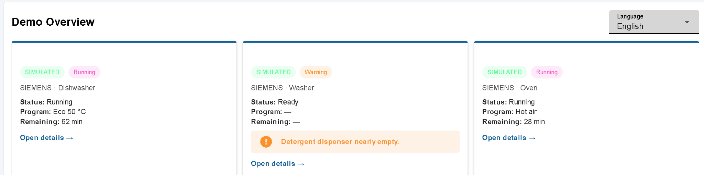
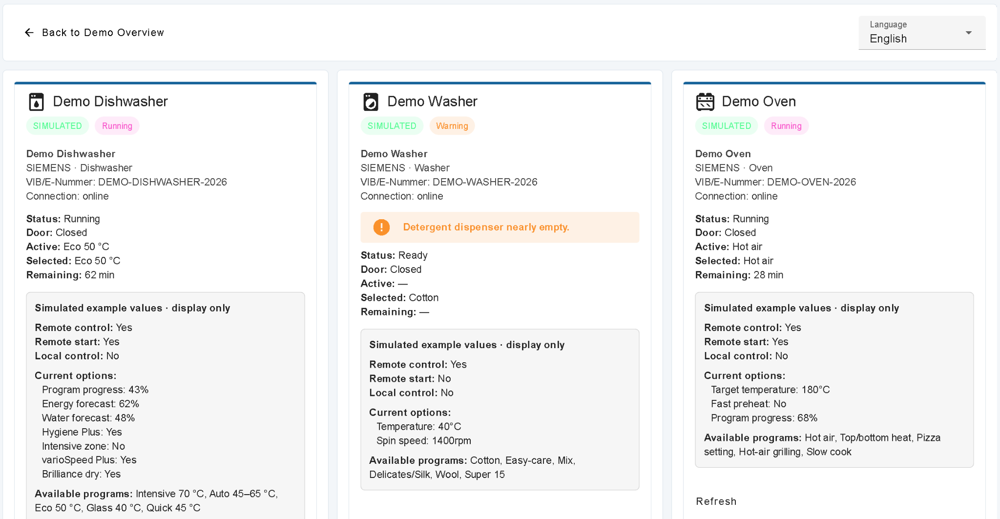

# @impact0815/node-red-contrib-home-connect

**[English](README.md) · Deutsch**

[](https://github.com/impact0815/node-red-contrib-home-connect/actions/workflows/ci.yml)
[](CHANGELOG.md)
[](LICENSE)

Node-RED-Nodes für Home Connect: direkte, nur lesende LAN-Anbindung über Geräteprofile sowie die bestehende offizielle Cloud-API mit OAuth, Discovery, SSE, Rate-Limit-Schutz, Health/Warnungen und abgesicherten Schreibzugriffen. Das Projekt folgt konzeptionell dem Discovery-first- und Safe-write-Ansatz von [`impact0815/node-red-contrib-viessmann`](https://github.com/impact0815/node-red-contrib-viessmann), ist aber eine eigenständige Implementierung für Home Connect.

> **Inoffizielles Community-Projekt.** Dieses Paket ist weder mit Home Connect GmbH oder BSH Hausgeräte GmbH noch mit Bosch, Siemens, Neff, Gaggenau oder anderen Marken verbunden, von ihnen freigegeben oder unterstützt. Nutzung auf eigenes Risiko. Gerätesteuerung kann Hitze, Bewegung, Wasserverbrauch und weitere Gefahren verursachen. Erst im Simulator und mit Dry-Run testen.

## Das Wichtigste vorab

- **Client ID und Client Secret kommen aus einer eigenen Application im Home Connect Developer Portal**, nicht aus der Home-Connect-App.
- Diese Version verwendet den **OAuth 2.0 Authorization Code Grant mit Client Secret und ohne PKCE**.
- Das **Client Secret ist geheim**. Nie in Screenshots, Foren, Issues, Flows oder Git-Repositories zeigen. Wurde es sichtbar, im Developer Portal regenerieren und neu autorisieren.
- Die Redirect URI muss im Developer Portal und in Node-RED **Zeichen für Zeichen identisch** sein.
- Eine Verbindung immer zuerst **speichern und deployen**, danach erneut öffnen und autorisieren.
- Das experimentelle lokale Protokoll ist undokumentiert und kann sich mit Firmware ändern. Lokaler Zugriff ist technisch **fest schreibgeschützt**; Profil-PSK/IV sind Geheimnisse.

## Funktionen

- vertraulicher OAuth-2.0-Authorization-Code-Flow, CSRF-State und Refresh-Token-Rotation
- Client Secret und Refresh Token im Node-RED-Credential-Store, nicht in exportierten Flows
- Production, China, offizieller Home-Connect-Simulator und integrierter Offline-Simulator
- rekursive Erkennung und Gruppierung zusammengehöriger Profile-Downloader-JSON/XML-Dateien mit genau einer zentralen Profil-zu-Host/IP-Zuordnung in der Config-Node
- direkte lokale WebSocket-Reads/-Events mit AES-CBC/HMAC oder TLS-PSK; die Verbindungsart steht standardmäßig auf **Auto** und kann zentral überschrieben werden
- serviceversionsgesteuerter Handshake und Leseablauf mit Verarbeitung unaufgeforderter Gerätewerte, Keepalive-Antworten und vollständigem Session-Neuaufbau
- optionaler bereinigter Protokoll-Mitschnitt im Speicher oder als geschützte JSONL-Datei, ohne PSK, IV, Schlüssel, Nonces oder Geräte-/Netzwerkkennungen
- Geräteauswahlen zeigen `Typ — verständlicher Name — Marke/Modell — …ID-Ende`; intern bleibt die vollständige technische ID unverändert
- strikte Prüfung auf private/link-lokale Ziele, Profil-JSON im Credential-Store und feste `LOCAL_READ_ONLY`-Schreibsperre
- profilbasierte Auflösung hexadezimaler XML-`uid`/`refUID`-Werte und referenzierter Enums in semantische Home-Connect-Schlüssel mit anschließender Einordnung in Status, Einstellungen, Werte und Programme
- Server-Sent Events (SSE) mit automatischem Reconnect
- normiertes Health-Modell `ok`, `running`, `info`, `warning`, `action_required`, `offline`, `error`
- deduplizierte Warnungen mit deutschen und englischen Texten aus Gerätestatus, Event-`level`/`handling`, Verbindung, API und OAuth; das Dashboard zeigt nur die gewählte Sprache
- klar getrennte Daten- und Fehlerausgänge
- persistentes, konfigurierbares 24-Stunden-Aufrufbudget mit gemeinsamem Zähler für gleiche Client IDs und 429-Circuit-Breaker
- abgesicherte Schreibzugriffe mit globaler Freigabe, Gerätetyp-Allowlist, Bestätigungstoken, Dry-Run und Live-Capability-Prüfung
- keine automatische Wiederholung von Schreibzugriffen
- deutsche und englische README, Hilfe, Troubleshooting und Beispiele
- Dashboard-2.0-Beispiel mit gespeicherter DE/EN-Sprachauswahl, lokalisierten UI-/Geräte-/Enum-/Programm-/Optionsnamen, initialem Snapshot, Teil-Event-Zusammenführung, Offline/Reconnect sowie Cloud- und Local-read-only-Pfad
- separater, vollständig simulierter und zugangsdatenfreier Screenshot-Flow für reproduzierbare GitHub-/npm-Dokumentationsbilder
- keine Runtime-Abhängigkeiten; Node.js ab 18 und Node-RED ab 3

## Installation

### Empfohlen: Node-RED-Palette

Nachdem das Paket auf npm veröffentlicht wurde:

1. In Node-RED **Menü → Palette verwalten → Installieren** öffnen.
2. Nach `@impact0815/node-red-contrib-home-connect` suchen.
3. **Installieren** anklicken und die Erfolgsmeldung abwarten.
4. Node-RED vollständig neu starten und den Browser mit **Strg+F5** neu laden.

### Kommandozeile

```bash
cd ~/.node-red
npm install @impact0815/node-red-contrib-home-connect@0.2.0
```

### Lokale TGZ-Datei

Die mitgelieferte Release-Datei kann direkt installiert werden, zum Beispiel vor der Aufnahme in die Palette:

```bash
cd ~/.node-red
npm install /absoluter/pfad/impact0815-node-red-contrib-home-connect-0.2.0.tgz
```

### Docker-Beispiel

```bash
docker exec node-red npm install --prefix /data @impact0815/node-red-contrib-home-connect@0.2.0
docker restart node-red
```

Für die mitgelieferte TGZ-Datei diese zuerst in den Container kopieren:

```bash
docker cp impact0815-node-red-contrib-home-connect-0.2.0.tgz node-red:/tmp/
docker exec node-red npm install --prefix /data /tmp/impact0815-node-red-contrib-home-connect-0.2.0.tgz
docker restart node-red
```

Installierten Build prüfen:

```bash
cd ~/.node-red
node -p "require('./node_modules/@impact0815/node-red-contrib-home-connect/BUILD-INFO.json')"
```

Erwartet werden `0.2.0`, `hc-0.2.0-final` und `pkce: false`. Unvollständige oder alte Autorisierungs-Links/Codes nicht weiterverwenden.

## Schritt für Schritt: Einrichtung für Einsteiger

### A. Erst ohne Konto ausprobieren

1. In Node-RED **Menü → Import → Beispiele → @impact0815/node-red-contrib-home-connect → 01-first-steps-device-list** wählen.
2. Deployen.
3. Links am Inject-Node auf den Knopf klicken.
4. Im Debug-Fenster erscheinen die drei ausschließlich lokalen Testgeräte.
5. Der integrierte Simulator baut keine Verbindung zu Home Connect auf und benötigt keine Zugangsdaten.

### B. Reale Geräte lokal anbinden (nur lesend)

1. Mit dem Community-[Home Connect Profile Downloader](https://github.com/bruestel/homeconnect-profile-downloader) die JSON/XML-Dateien der Geräte exportieren.
2. Den entpackten Ordner mit restriktiven Dateirechten auf dem Node-RED-Host speichern; bei Docker beispielsweise unter `/data/homeconnect-profiles` nur lesend einbinden. Einzutragen ist der Pfad **im Node-RED-Container**, nicht der Pfad auf dem Notebook.
3. Neue Home-Connect-Konfiguration erstellen und **Local LAN (read-only)** wählen.
4. Den serverseitigen Profilordner eintragen und **Profile suchen / Geräte erkennen** anklicken. Der rekursive Scanner gruppiert je Gerät das Geräte-JSON mit `DeviceDescription.xml` und `FeatureMapping.xml`. Das Ergebnis lautet zum Beispiel **3 Geräteprofile gefunden**. Unvollständige Sätze und doppelte Profil-IDs werden separat genannt und müssen im Ordner korrigiert werden.
5. Für jedes vollständige Geräteprofil erscheint eine eigene Karte. Dort genau einen Host bzw. eine IP eintragen. Fehlende, formal falsche, öffentliche und nicht lokale Ziele werden markiert. **Verbindungsart: Auto (empfohlen)** beibehalten; Auto respektiert zuerst die deklarierte AES-/TLS-/PSK-Art des Profils und verwendet das IV nur als Fallback.
6. In jeder Gerätekarte **Verbindung testen** anklicken. Der Test verwendet auch vor **Fertig/Deployen** immer die gerade sichtbare Host/IP und Verbindungsart. Er zeigt einzeln IP-Erreichbarkeit, Profil, Transport, WebSocket, Session, Services und Read-only-Daten. Abgelehnte Protokollressourcen nennen Aktion, Version und Gerätecode; Netzwerkfehler bleiben davon getrennt. Es wird nie ein Schreibzugriff gesendet.
7. **Fertig → Deployen**. Die Oberfläche serialisiert `localDeviceMappings` bei jeder Kartenänderung und nochmals beim Speichern. Dadurch bleiben genau diese Zuordnungen nach dem Deploy erhalten; kein Mapping-JSON selbst schreiben.
8. Im Read-Node nur das konfigurierte Gerät und die Lese-Ressource auswählen. Im Events-Node ein Gerät oder **Alle konfigurierten Geräte** auswählen. Beide Nodes besitzen kein eigenes Host-/IP-Feld.
9. Kein Write-Node für lokale Zugriffe verwenden: `LOCAL_READ_ONLY` weist jeden Schreibversuch vor lokalem Netzwerkzugriff ab.

Unter **Erweitert** ist **Profil-JSON manuell einfügen (optional)** nur ein Ausweichweg. Entweder Ordner oder manuelles JSON verwenden. Bei gesetztem Ordner ist der manuelle Editor standardmäßig eingeklappt/deaktiviert und wird ignoriert. Eine Schaltfläche erzeugt das optionale Credential-JSON aus erkannten Profilen und fertigen Zuordnungen; niemand muss Platzhalter, Beispielschlüssel oder Mapping-JSON von Hand schreiben. Dort kann außerdem zeitweise der sichere Protokoll-Mitschnitt aktiviert werden: ohne Pfad nur als begrenzte Testanzeige, mit absolutem Pfad unter POSIX als JSONL `0600`; sensible Felder werden entfernt. Unter Windows den Pfad per NTFS-ACL auf das Dienstkonto beschränken, weil POSIX-Rechte dort nicht zuverlässig sind.

Die Runtime verbindet nur private/link-lokale Ziele über `ws://host:80/homeconnect` (AES/HMAC) oder `wss://host:443/homeconnect` (TLS-PSK). PSK/IV werden nie ausgegeben. Vollständige Einrichtung, Docker, Protokollgrenze und Fehlerbehebung: **[Lokale-LAN-Anleitung](docs/LOCAL-LAN.de.md)**.

Geräteauswahlen verwenden kompakte Bezeichnungen wie `Dishwasher — Geschirrspüler — Siemens SX678X36TE — …4576`. Das gekürzte Ende dient nur der Anzeige; Flow und Runtime verwenden weiterhin die vollständige, unveränderte technische ID.

### C. Eigene Application im Developer Portal anlegen

1. Beim [Home Connect Developer Portal](https://developer.home-connect.com/) anmelden.
2. Eine **eigene Application** erstellen.
3. **Authorization Code Grant Flow** auswählen.
4. Ein Client Secret erzeugen.
5. **PKCE deaktiviert lassen**, weil diese Paketvariante keine PKCE-Parameter sendet.
6. Die später in Node-RED verwendete Redirect URI registrieren.
7. Client ID und Client Secret sicher aufbewahren.

Client ID und Client Secret stammen **nicht** aus der Home-Connect-App auf dem Smartphone.

### D. Die richtige Redirect URI festlegen

Schema:

```text
https://<vom-browser-erreichbarer-node-red-host>:<port>/home-connect/oauth/callback
```

Beispiel mit rein fiktivem Hostnamen:

```text
https://nodered.example.net/home-connect/oauth/callback
```

Die Zeichenfolge muss auf beiden Seiten identisch sein:

- gleiches `http` oder `https`
- gleicher Hostname
- gleicher Port
- Pfad endet exakt auf `/home-connect/oauth/callback`
- **kein** Slash am Ende

**Wichtig zu localhost:** `localhost` bezeichnet immer den Rechner, auf dem der Browser läuft. Es funktioniert daher nur, wenn Browser und Node-RED auf demselben Rechner laufen. Bei Node-RED auf NAS, Raspberry Pi, Server oder Container einen vom Browser erreichbaren Hostnamen bzw. eine erreichbare IP-Adresse verwenden.

### E. Cloud-Verbindung in Node-RED anlegen

1. Einen Home-Connect-Node auf die Arbeitsfläche ziehen.
2. Bei **Verbindung** eine neue `home-connect-config` anlegen.
3. Eindeutigen Namen verwenden, zum Beispiel `Home Connect Production – Zuhause`. Eine Production-Verbindung nicht `Simulator` nennen.
4. Umgebung auswählen.
5. Client ID, Client Secret und die exakte Redirect URI eintragen.
6. Mit möglichst kleinen Scopes starten.
7. Das lokale Budget zunächst bei **900 API-Aufrufen pro 24 Stunden** und den Mindestabstand bei **250 ms** belassen.
8. Zunächst **Schreibzugriff erlauben** ausgeschaltet lassen.
9. **Fertig** klicken.
10. **Deployen**.
11. Die Verbindung erneut öffnen. Erst jetzt ist **Autorisieren** aktiv.
12. **Autorisieren** anklicken, bei Home Connect anmelden und den Zugriff bestätigen.
13. Erfolgreich ist der Vorgang, wenn im Browser **Home Connect authorized** erscheint.
14. Fenster schließen, in Node-RED **Test** anklicken. Danach werden Geräte in den Geräteauswahlen automatisch angeboten.

## Scopes verständlich erklärt

`IdentifyAppliance` wird für die Geräteliste benötigt. Weitere Rechte möglichst gerätespezifisch vergeben.

| Zweck | Beispiel |
|---|---|
| Nur Geräte erkennen | `IdentifyAppliance` |
| Geschirrspüler, Waschmaschine und Backofen beobachten | `IdentifyAppliance Dishwasher-Monitor Washer-Monitor Oven-Monitor` |
| Dashboard lesen und steuern | `IdentifyAppliance Dishwasher-Monitor Dishwasher-Control Dishwasher-Settings Washer-Monitor Washer-Control Washer-Settings Oven-Monitor Oven-Control Oven-Settings` |

Der allgemeine Scope `Monitor` reicht je nach Application/Konto nicht immer aus. Nach jeder Scope-Änderung muss neu autorisiert werden, damit ein neuer Refresh Token mit den neuen Rechten gespeichert wird.

## Normiertes Health-/Warning-Modell

Alle Discover-, Read-, Event-, Write- und Fehlerausgaben enthalten `msg.health`, `msg.warnings` und dieselben Angaben unter `msg.homeConnect`. Snapshots und Discovery-Einträge tragen zusätzlich `payload.health`, `payload.warnings`, `payload.healthSchema` und `payload.healthAt`. Dashboard-Flows müssen deshalb Home-Connect-Enums nicht selbst bewerten.

```js
msg.health = 'action_required';
msg.warnings = [{
  source: 'status',
  code: 'HC_OPERATION_ACTION_REQUIRED',
  severity: 'critical',
  text: {
    de: 'Das Gerät benötigt eine Aktion vor Ort.',
    en: 'The appliance requires an action on site.'
  },
  transient: false
}];
```

Das Modell berücksichtigt insbesondere `OperationState`, `DoorState`, `RemoteControlActive`, `RemoteControlStartAllowed`, `LocalControlActive`, Geräte-/SSE-Verbindung, Event-`level` und `handling`, OAuth-Zustände, API-Fehler und Rate Limits. Kurzlebige Meldungen wie `Finished`, normale Geräte-Events und `CONNECTED` werden dedupliziert und laufen automatisch ab. `DISCONNECTED`/offline bleibt bestehen, bis ein Verbindungs- oder Snapshot-Signal die Erholung bestätigt. Rohwerte bleiben erhalten, damit neue Enums nicht verloren gehen.

## Enthaltene Nodes

| Node | Aufgabe |
|---|---|
| **Home Connect API** | gemeinsame lokale Read-only- oder Cloud-OAuth-Konfiguration, Scopes und Cloud-Schreibfreigabe |
| **Home Connect discover** | eigene Geräte und Capabilities dynamisch laden |
| **Home Connect read** | Status, Einstellungen, Programme, Optionen, Bilder und unterstützte Map-Ressourcen lesen |
| **Home Connect events** | lokale WebSocket- oder Cloud-SSE-Events für alle oder ein Gerät empfangen |
| **Home Connect write** | Cloud-Programme, -Einstellungen und -Befehle abgesichert senden; lokal immer gesperrt |

Jeder Funktions-Node hat zwei Ausgänge: **Daten/Ergebnis/Event** und **strukturierter Fehler**.

## Beispiel-Flows

Unter **Import → Beispiele → @impact0815/node-red-contrib-home-connect**. Einsteigerfreundliche Anleitungen stehen in der [deutschen Examples-README](examples/README.de.md) und der [englischen Examples-README](examples/README.md).

| Datei | Inhalt |
|---|---|
| `01-first-steps-device-list.json` | einfachster Einstieg: integrierter Simulator und Geräteliste |
| `02-events.json` | gemeinsamer Event-Stream, Filterung und Debug-Ausgabe |
| `03-safe-read-write.json` | Snapshot lesen und einen Schreibvorgang nur als Dry-Run prüfen |
| `04-local-read-only.json` | anonymisierter lokaler Discover-/Read-/Events-Flow ohne Write-Node |
| `dashboard-dishwasher-washer-oven.json` | Dashboard 2.0: automatische/gespeicherte DE/EN-Anzeige, initialer Snapshot, lokale/Cloud-Event-Zusammenführung, letzter bekannter Zustand, Offline/Reconnect, Übersicht und Detailkarten |
| `dashboard-screenshot-simulated.json` | zugangsdatenfreie, deterministische Screenshot-Demo mit drei klar als simuliert markierten Geräten; nur Node-RED Dashboard 2 wird benötigt |
| `demo-home-connect-flowfuse-1.34.1-scriptless.json` | isolierter Demo-Flow mit skriptfreien Templates für FlowFuse Dashboard 1.34.1; deterministisch sowie ohne Zugangsdaten und Netzwerkzugriff |

Für das Dashboard wird zusätzlich `@flowfuse/node-red-dashboard` benötigt:

```bash
cd ~/.node-red
npm install @flowfuse/node-red-dashboard
```

Die Beispiele laufen zuerst mit dem integrierten Simulator. Für reale Geräte entweder eine lokale Read-only-Verbindung oder eine autorisierte Production-Cloud-Verbindung verwenden, Geräteliste laden und die Verbindung in den Home-Connect-Nodes austauschen. Der gemeinsame Reducer verarbeitet vollständige Snapshots und partielle `STATUS`-/`NOTIFY`-Events, ohne nicht enthaltene Felder zu löschen. Bei Offline bleibt der letzte bekannte Zustand sichtbar; nach Reconnect laufen Aktualisierungen automatisch weiter. Bei `readOnly` sind Bedienelemente deaktiviert; Cloud-Write-Nodes zunächst im Dry-Run lassen. Technische Schlüssel bleiben intern unverändert; nur die Benutzeranzeige wird lokalisiert. Hinweise zur Sprachwahl und zum Screenshot-Flow stehen in der [Dashboard-Anleitung](docs/DASHBOARD.de.md).

## Dokumentations-Screenshots

Die Release-Dokumentation verwendet ausschließlich die isolierte simulierte Demo und enthält zwei geprüfte Aufnahmen:





Beide geprüften Bilder verwenden die englische Oberfläche und zeigen ausschließlich `SIMULATED`-Demo-Daten. `npm run release:check` verhindert die Veröffentlichung, wenn eine Datei fehlt, strukturell ungültig ist oder vom geprüften, durch den Benutzer bereitgestellten PNG abweicht. Die abgeschlossene Sichtprüfung fand keine Browserprofile, Hostnamen, Adressen, Kontonamen, echten Gerätekennungen, Tokens, QR-Codes, Profile oder fremden Tabs/Fenster.

## Geräteinformationen und Firmware – wichtige Grenze

Die öffentlich dokumentierte Home-Connect-API liefert Geräteinformationen wie Name, Marke, Gerätetyp, `vib`/E-Nummer und Verbindungsstatus, soweit das jeweilige Gerät bzw. Konto sie bereitstellt. Diese Werte werden in Discovery und im Dashboard sinnvoll angezeigt.

**Firmwareversion, Firmwarehistorie und Firmwareupdate gehören nicht zur öffentlich dokumentierten API.** Dieses Paket zeigt keine erfundene Firmwarefunktion, verwendet keine undokumentierten Firmware-Endpunkte und versucht nicht, Updates auszulösen. Firmware und Updates ausschließlich über die offiziellen Hersteller-/Home-Connect-Wege prüfen.

## Troubleshooting / FAQ

### `CONFIG_NOT_FOUND` beim Start der Autorisierung

Die Schaltfläche bzw. ein alter Flow verweist auf eine Config-Node, die nicht in der laufenden Runtime existiert. Häufig wurde ein Beispiel-/Simulator-Flow kopiert oder noch nicht deployt.

**Lösung:** richtige Verbindung auswählen → **Fertig** → **Deployen** → Verbindung erneut öffnen → neue Autorisierung starten. Keine alte Browser-Registerkarte weiterverwenden.

### Name und Umgebung passen nicht zusammen

Ein Name wie `Simulator` bei ausgewählter Production-Umgebung ist technisch möglich, führt aber leicht zur falschen Verbindung. Die Oberfläche warnt jetzt davor. Eindeutig umbenennen und erneut deployen.

### Nach dem Login erscheint `ERR_EMPTY_RESPONSE` oder „Verbindung fehlgeschlagen“ auf localhost

Der Browser wurde zu `localhost` zurückgeschickt, Node-RED läuft aber auf einem anderen Rechner. Die Redirect URI im Developer Portal und in Node-RED auf einen vom Browser erreichbaren Node-RED-Host ändern, exakt abgleichen, deployen und OAuth neu beginnen.

### `unauthorized_client` / `client or redirection URI not authorized`

Meist stimmt die Redirect URI nicht exakt überein. Protokoll, Host, Port, Pfad und abschließenden Slash prüfen. Außerdem sicherstellen, dass in der Developer-Portal-Application PKCE deaktiviert ist. Diese Build-Variante sendet keine PKCE-Parameter.

### Nach dem Paketupdate läuft weiterhin alter Code

Node-RED lädt Runtime-Code nur beim Start. Alte Installation entfernen, neues TGZ mit `--force` installieren, Node-RED bzw. Container vollständig neu starten und Browser hart neu laden. Build-Info prüfen. Danach OAuth komplett neu starten; alte Auth-URLs und einmalige Codes sind ungültig.

### `No refresh token is stored. Complete OAuth authorization first.`

OAuth wurde nicht erfolgreich abgeschlossen. Autorisierung neu starten und warten, bis **Home Connect authorized** angezeigt wird. Erst danach `Test`, Discover, Read oder Events verwenden.

### `insufficient_scope`

Der gespeicherte Token besitzt nicht die benötigten Rechte. `IdentifyAppliance` plus passende gerätespezifische Scopes eintragen, speichern, deployen und neu autorisieren. Nur den Text im Scope-Feld zu ändern aktualisiert einen vorhandenen Token nicht.

### Events-Node bleibt auf `reconnecting`

Meist fehlen Autorisierung oder Event-/Monitor-Scopes. Zuerst mit **Test** bzw. dem Gerätelisten-Beispiel prüfen, ob Geräte geladen werden. Fehlerausgang des Events-Nodes ansehen, Scopes korrigieren und neu autorisieren. Wegen API-Grenzen möglichst nur einen Stream für alle Geräte verwenden.

### `health`, `warnings` und Rate Limit

`health` ist die verdichtete Bewertung; `warnings` enthält stabile Codes und deutsche/englische Texte. Der Konfigurations-Node begrenzt standardmäßig auf **900 API-Aufrufversuche in jedem rollierenden 24-Stunden-Fenster** und lässt damit 100 Aufrufe Reserve zum Anbieterlimit von 1000. Zulässig sind 1 bis 1000; für gemeinsam verwendete Client IDs gilt innerhalb dieses Node-RED-Prozesses die strengste aktive Konfiguration. REST-Aufrufe, Wiederholungen und SSE-Verbindungsversuche zählen jeweils einzeln. Der Zähler wird unter dem Node-RED-`userDir` in `.home-connect` persistiert und über Deploys/Neustarts hinweg weitergeführt.

Ist das lokale Budget erschöpft, wird **vor dem Netzwerkzugriff** ein strukturierter Fehler `LOCAL_RATE_LIMITED` mit `retryAfter` und `resetAt` ausgegeben. Meldet Home Connect HTTP 429, wird auch eine im Fehlertext enthaltene Restdauer wie `75502 seconds` erkannt, persistent gespeichert und als Circuit Breaker verwendet; währenddessen sendet dieses Paket keine weiteren Home-Connect-API-Aufrufe. Eine 429-Antwort wird nicht automatisch wiederholt. Andere Hosts oder Programme mit derselben Home-Connect-Application können nicht koordiniert werden; deshalb die Reserve nicht ohne Grund auf 1000 erhöhen und nur einen Config-Node pro Client ID verwenden.

Bei `HC_API_RATE_LIMITED` Polling reduzieren und `retryAfter` beachten. Bei `HC_OAUTH_INSUFFICIENT_SCOPE` oder `HC_OAUTH_AUTHORIZATION_EXPIRED` Scopes bzw. Autorisierung korrigieren und anschließend neu autorisieren. Das Dashboard deaktiviert Startaktionen bei offline, Fehler, notwendiger Aktion oder blockierter Fernsteuerung.

### Woran erkenne ich Erfolg?

Der Callback zeigt **Home Connect authorized**. Danach meldet **Test** die Anzahl der Geräte, und **Geräte laden** befüllt die Auswahl automatisch.

Die ausführliche Entscheidungshilfe steht in [Troubleshooting (DE)](docs/TROUBLESHOOTING.de.md).

## Sicherheit

- In `settings.js` ein starkes `credentialSecret` setzen, bevor Credentials gespeichert werden.
- Editor, Dashboard und Callback per HTTPS und Authentifizierung schützen.
- Client Secret, Tokens, echte Hostnamen, Geräte-IDs und OAuth-Codes nie in Issues oder Screenshots veröffentlichen.
- Bei offengelegtem Secret dieses sofort im Developer Portal regenerieren und neu autorisieren.
- Nur minimale Scopes anfordern.
- `allowWrite` standardmäßig auslassen; neue Schreibaktionen erst mit Dry-Run prüfen.
- Für Schreib-Nodes eigenes Bestätigungstoken und Gerätetyp-Allowlist verwenden.
- Herstellerhinweise und Home-Connect-Bedingungen beachten.

Mehr: [SECURITY.md](SECURITY.md).

## Entwicklung und Prüfung

```bash
npm run validate
```

Die Prüfung umfasst Syntax, JSON/Flow-Dateien, Unit- und Simulator-Integrationstests sowie `npm pack --dry-run`. GitHub Actions testet mit Node.js 18, 20 und 22.

## Weitere Dokumentation

- [Troubleshooting (DE)](docs/TROUBLESHOOTING.de.md)
- [Architektur](docs/ARCHITECTURE.md)
- [Message API](docs/MESSAGE-API.md)
- [API-Abdeckung](docs/API-COVERAGE.md)
- [Dashboard (DE)](docs/DASHBOARD.de.md)
- [Beitragen](CONTRIBUTING.md)
- [Changelog](CHANGELOG.md)

## Lizenz

MIT, siehe [LICENSE](LICENSE) und [NOTICE](NOTICE).
