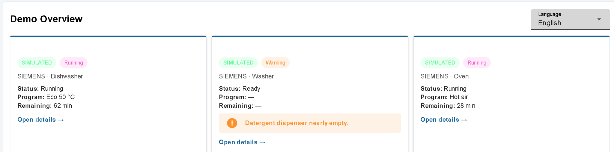
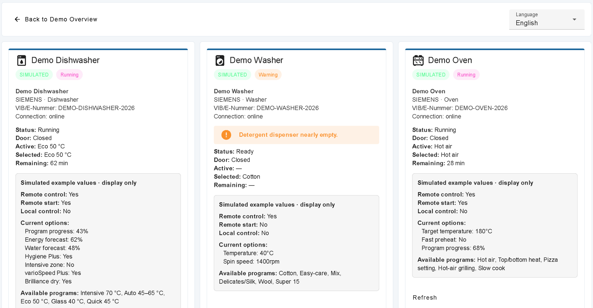

# node-red-contrib-home-connect

**English · [Deutsch](README.de.md)**

[](https://github.com/impact0815/node-red-contrib-home-connect/actions/workflows/ci.yml)
[](CHANGELOG.md)
[](LICENSE)

Node-RED nodes for Home Connect: direct, read-only LAN access to appliance profiles plus the existing official cloud API with OAuth, discovery, SSE, rate-limit protection, health/warnings, and guarded writes. The project conceptually follows the discovery-first and safe-write approach of [`impact0815/node-red-contrib-viessmann`](https://github.com/impact0815/node-red-contrib-viessmann), but is an independent Home Connect implementation.

> **Unofficial community project.** This package is not affiliated with, endorsed by, or supported by Home Connect GmbH, BSH Hausgeräte GmbH, Bosch, Siemens, Neff, Gaggenau, or any other brand. Use it at your own risk. Appliance control can create heat, motion, water use, and other hazards. Test with the simulator and dry-run first.

## Read this first

- **Client ID and Client Secret come from your own Application in the Home Connect Developer Portal**, not from the Home Connect mobile app.
- This build uses the **OAuth 2.0 Authorization Code Grant with a client secret and without PKCE**.
- The **Client Secret is confidential**. Never publish it in screenshots, forums, issues, flows, or Git repositories. If exposed, regenerate it in the Developer Portal and authorize again.
- The Redirect URI in the Developer Portal and Node-RED must match **character for character**.
- Always **save and deploy** a connection before reopening it and starting authorization.
- The experimental local protocol is undocumented and can change with firmware. Local access is **hard read-only**; profile PSK/IV values are secrets.

## Features

- confidential OAuth 2.0 Authorization Code flow, CSRF state, and refresh-token rotation
- Client Secret and refresh token in the Node-RED credential store, not exported flows
- Production, China, official Home Connect simulator, and built-in offline simulator
- recursive discovery and grouping of Profile Downloader JSON/XML sets, with one central profile-to-Host/IP assignment in the configuration node
- direct local WebSocket reads/events over AES-CBC/HMAC or TLS-PSK; transport defaults to **Auto** from the profile and can be overridden centrally
- service-version-driven handshake/read sequencing, unsolicited appliance values, housekeeping responses, and complete session rebuilds
- optional sanitized in-memory or protected JSONL protocol trace with no PSK, IV, keys, nonces, or appliance/network identifiers
- selectors show `type — friendly name — brand/model — …ID suffix`; the complete technical ID remains unchanged internally
- strict local-only host validation, credential-backed profile JSON, and an unconditional `LOCAL_READ_ONLY` write barrier
- profile-based resolution of hexadecimal XML `uid`/`refUID` values and referenced enums into semantic Home Connect keys, followed by automatic status/setting/value/program classification
- Server-Sent Events (SSE) with automatic reconnect
- normalized health model: `ok`, `running`, `info`, `warning`, `action_required`, `offline`, `error`
- deduplicated warnings carrying German and English text from appliance status, event `level`/`handling`, connection, API, and OAuth; the Dashboard displays only the selected language
- separate data and structured-error outputs
- persistent, configurable 24-hour request budget shared by equal Client IDs, with an HTTP 429 circuit breaker
- guarded writes with global enable, appliance-type allowlist, confirmation token, dry-run, and live capability checks
- no automatic retries of write requests
- English and German README, help, troubleshooting, and examples
- Dashboard 2.0 example with saved DE/EN selection, localized UI/appliance/enum/program/option names, initial snapshots, partial-event merging, offline/reconnect, and cloud plus local read-only paths
- separate fully simulated, credential-free screenshot flow for reproducible GitHub/npm documentation images
- zero runtime dependencies; Node.js 18+ and Node-RED 3+

## Installation

### Local TGZ file

```bash
cd ~/.node-red
npm install /absolute/path/node-red-contrib-home-connect-0.2.0.tgz
```

Restart Node-RED completely and reload the browser with **Ctrl+F5**.

### Docker example

```bash
docker cp node-red-contrib-home-connect-0.2.0.tgz node-red:/tmp/
docker exec node-red npm install --prefix /data /tmp/node-red-contrib-home-connect-0.2.0.tgz
docker restart node-red
```

### Upgrade from 0.1.0

Replace the old package cleanly so Node-RED cannot load a stale copy:

```bash
cd ~/.node-red
npm uninstall node-red-contrib-home-connect
rm -rf node_modules/node-red-contrib-home-connect
npm install --force /absolute/path/node-red-contrib-home-connect-0.2.0.tgz
node -p "require('./node_modules/node-red-contrib-home-connect/BUILD-INFO.json')"
```

Expect `hc-0.2.0-final` and `pkce: false`. Restart the container when applicable. Existing cloud configuration remains compatible; do not reuse incomplete or old authorization links/codes.

## Step-by-step setup for non-technical users

### A. Try it without an account

1. In Node-RED choose **Menu → Import → Examples → node-red-contrib-home-connect → 01-first-steps-device-list**.
2. Deploy.
3. Click the Inject button on the left.
4. The Debug sidebar shows three local test appliances.
5. The built-in simulator makes no external Home Connect connection and needs no credentials.

### B. Connect real appliances locally (read-only)

1. Use the community [Home Connect Profile Downloader](https://github.com/bruestel/homeconnect-profile-downloader) to export the appliance JSON/XML files.
2. Store the extracted directory on the Node-RED host with restrictive filesystem permissions. In Docker, mount it read-only, for example at `/data/homeconnect-profiles`. The path must be the path **inside the Node-RED container**, not a path on your laptop.
3. Create a Home Connect configuration and choose **Local LAN (read-only)**.
4. Enter the server-side profile directory and click **Scan profiles / Detect devices**. The recursive scanner groups each appliance JSON with its matching `DeviceDescription.xml` and `FeatureMapping.xml`. The result says, for example, **3 device profiles found**. Incomplete sets and duplicate profile IDs are listed separately and must be fixed in the folder.
5. A card appears for every complete device profile. Enter one Host/IP in each card. Missing, malformed, public, and non-local addresses are marked. Leave **Connection type** at **Auto (recommended)**; Auto honors the profile's declared AES/TLS/PSK transport first and uses IV presence only as a fallback.
6. Click **Test connection** in every device card. Even before Done/Deploy, it uses the visible Host/IP and transport and shows separate stages for IP reachability, profile, transport, WebSocket, session, services, and read-only data. Rejected protocol resources identify action, version, and device code while network failures remain a separate class. It never sends a write request.
7. Click **Done → Deploy**. The editor serializes `localDeviceMappings` on every card change and once more on Done, so the exact assignments persist after deploy; do not create mapping JSON yourself.
8. In a Read node select only the configured appliance and read resource. In an Events node select one configured appliance or **All configured appliances**. Neither node contains a Host/IP field.
9. Do not attach a Write node: local writes are always rejected with `LOCAL_READ_ONLY` before local network I/O.

Under **Advanced**, **Paste profile JSON manually (optional)** is a fallback. Use either the folder or manual JSON. When a folder is set, the manual editor is collapsed/disabled and ignored. A button can generate the optional credential JSON from the detected profiles and completed mappings; no placeholder, sample key, or hand-written mapping is required. The same section can temporarily enable the safe protocol trace: with no path it is a bounded test display; with an absolute path it is JSONL mode `0600`, with sensitive fields removed.

The runtime connects only to private/link-local targets at `ws://host:80/homeconnect` (AES/HMAC) or `wss://host:443/homeconnect` (TLS-PSK). PSK/IV are never emitted. Full setup, Docker, protocol boundary, and troubleshooting: **[Local LAN guide](docs/LOCAL-LAN.md)**.

Appliance selectors use concise labels such as `Dishwasher — Geschirrspüler — Siemens SX678X36TE — …4576`. The shortened suffix is display-only; flows and runtime calls continue to use the full unmodified technical ID.

### C. Create your own Developer Portal Application

1. Sign in to the [Home Connect Developer Portal](https://developer.home-connect.com/).
2. Create your **own Application**.
3. Select the **Authorization Code Grant Flow**.
4. Generate a Client Secret.
5. Keep **PKCE disabled**, because this package build sends no PKCE parameters.
6. Register the Redirect URI that Node-RED will use.
7. Store the Client ID and Client Secret securely.

These values do **not** come from the Home Connect mobile app.

### D. Choose the correct Redirect URI

Pattern:

```text
https://<node-red-host-reachable-from-your-browser>:<port>/home-connect/oauth/callback
```

Example using a deliberately fictional hostname:

```text
https://nodered.example.net/home-connect/oauth/callback
```

The string must be identical in both places:

- same `http` or `https`
- same hostname
- same port
- path ends exactly with `/home-connect/oauth/callback`
- **no** trailing slash

**About localhost:** `localhost` always means the computer running the browser. Use it only when the browser and Node-RED run on the same computer. For Node-RED on a NAS, Raspberry Pi, server, or container, use a Node-RED hostname or IP address that the browser can reach.

### E. Create the cloud Node-RED connection

1. Add a Home Connect node to the workspace.
2. Create a new `home-connect-config` under **Connection**.
3. Use a clear name such as `Home Connect Production – Home`. Do not name a Production connection `Simulator`.
4. Select the environment.
5. Enter the Client ID, Client Secret, and exact Redirect URI.
6. Start with the smallest practical scopes.
7. Initially keep the local budget at **900 API calls per 24 hours** and the minimum interval at **250 ms**.
8. Leave **Allow write access** off initially.
9. Click **Done**.
10. **Deploy**.
11. Reopen the connection. Only now is **Authorize** enabled.
12. Click **Authorize**, sign in to Home Connect, and grant access.
13. Authorization has finished when the browser displays **Home Connect authorized**.
14. Close that window and click **Test** in Node-RED. Appliances then appear automatically in the appliance selectors.

## Scopes in plain language

`IdentifyAppliance` is required for the appliance list. Add appliance-specific permissions when possible.

| Purpose | Example |
|---|---|
| Discover appliances only | `IdentifyAppliance` |
| Monitor dishwasher, washer, and oven | `IdentifyAppliance Dishwasher-Monitor Washer-Monitor Oven-Monitor` |
| Read and control the example dashboard | `IdentifyAppliance Dishwasher-Monitor Dishwasher-Control Dishwasher-Settings Washer-Monitor Washer-Control Washer-Settings Oven-Monitor Oven-Control Oven-Settings` |

The generic `Monitor` scope is not sufficient for every Application/account. After changing scopes, authorize again so a new refresh token receives the changed permissions.

## Normalized health and warning model

Every Discover, Read, Events, Write, and error output contains `msg.health`, `msg.warnings`, and the same information under `msg.homeConnect`. Snapshots and discovery entries additionally carry `payload.health`, `payload.warnings`, `payload.healthSchema`, and `payload.healthAt`. Dashboard flows therefore do not need to interpret Home Connect enums themselves.

```js
msg.health = 'action_required';
msg.warnings = [{
  source: 'status',
  code: 'HC_OPERATION_ACTION_REQUIRED',
  severity: 'critical',
  text: {
    de: 'Das Gerät benötigt eine Aktion vor Ort.',
    en: 'The appliance requires an action on site.'
  },
  transient: false
}];
```

The model covers `OperationState`, `DoorState`, `RemoteControlActive`, `RemoteControlStartAllowed`, `LocalControlActive`, appliance/SSE connectivity, event `level` and `handling`, OAuth state, API errors, and rate limits. Short-lived notices such as `Finished`, ordinary appliance events, and `CONNECTED` are deduplicated and expire automatically. `DISCONNECTED`/offline remains until a connection or snapshot signal confirms recovery. Raw values are preserved so future enum values are not lost.

## Included nodes

| Node | Purpose |
|---|---|
| **Home Connect API** | shared local read-only or cloud OAuth configuration, scopes, and cloud write enable |
| **Home Connect discover** | dynamically load the user's appliances and capabilities |
| **Home Connect read** | read status, settings, programs, options, images, and supported map resources |
| **Home Connect events** | receive local WebSocket or cloud SSE events for all appliances or one appliance |
| **Home Connect write** | send cloud programs, settings, and commands through safety checks; local is always rejected |

Every functional node has two outputs: **data/result/event** and **structured error**.

## Example flows

Find these under **Import → Examples → node-red-contrib-home-connect**:

| File | Content |
|---|---|
| `01-first-steps-device-list.json` | simplest start: built-in simulator and appliance list |
| `02-events.json` | one all-appliance event stream, filtering, and Debug output |
| `03-safe-read-write.json` | read a snapshot and validate a write as dry-run only |
| `04-local-read-only.json` | anonymized local Discover/Read/Events flow with no Write node |
| `dashboard-dishwasher-washer-oven.json` | Dashboard 2.0: automatic/saved DE/EN display, initial snapshot plus local/cloud event merging, retained last-known state, offline/reconnect handling, compact overview, and detail cards |
| `dashboard-screenshot-simulated.json` | credential-free deterministic screenshot demo with three clearly simulated appliances; requires only Node-RED Dashboard 2 |
| `demo-home-connect-flowfuse-1.34.1-scriptless.json` | isolated, scriptless-template Demo flow supplied for FlowFuse Dashboard 1.34.1; deterministic, credential-free, and network-free |

The dashboard also requires `@flowfuse/node-red-dashboard`:

```bash
cd ~/.node-red
npm install @flowfuse/node-red-dashboard
```

The examples start with the built-in simulator. For real appliances, either use a local read-only connection or authorize a Production cloud connection, load the appliance list, and replace the connection in the Home Connect nodes. The shared reducer accepts complete snapshots and partial `STATUS`/`NOTIFY` events without clearing fields that were not part of the update. Offline events retain the last known values, and reconnect events resume live updates. Local controls are disabled by `readOnly`; cloud write nodes must stay in dry-run first. Technical keys remain unchanged internally; localization affects display only. See the [Dashboard guide](docs/DASHBOARD.md) for language selection and screenshot-flow instructions.

## Documentation screenshots

The release documentation uses only the isolated simulated Demo and includes two reviewed captures:





Both reviewed images use the English UI and show only `SIMULATED` Demo data. `npm run release:check` refuses publication if either file is missing, structurally invalid, or differs from the reviewed user-provided PNG. The completed visual review found no browser profiles, hostnames, addresses, account names, real appliance identifiers, tokens, QR codes, profiles, or unrelated tabs/windows.

## Appliance information and firmware — an important boundary

The publicly documented Home Connect API exposes appliance information such as name, brand, appliance type, `vib`/E-number, and connection state when supplied by the appliance/account. Discovery and the Dashboard display these values where available.

**Firmware version, firmware history, and firmware update are not provided by the publicly documented API.** This package does not pretend to implement firmware features, does not call undocumented firmware endpoints, and does not attempt to trigger updates. Check firmware and updates only through official manufacturer/Home Connect channels.

## Troubleshooting / FAQ

### `CONFIG_NOT_FOUND` when authorization starts

The button or an imported flow refers to a configuration node that is not present in the running Node-RED runtime. A simulator/example configuration may have been referenced, or the new configuration was not deployed.

**Fix:** select the correct connection → **Done** → **Deploy** → reopen the connection → start a new authorization. Do not continue in an old browser tab.

### Connection name and environment do not match

A name such as `Simulator` with the Production environment is technically possible but easy to misuse. The editor now warns about this. Rename it clearly and deploy again.

### The browser shows `ERR_EMPTY_RESPONSE` or connection failed on localhost after sign-in

Home Connect redirected the browser to `localhost`, but Node-RED runs on another computer. Change the Redirect URI in both the Developer Portal and Node-RED to a Node-RED host reachable from the browser, match it exactly, deploy, and start OAuth again.

### `unauthorized_client` / `client or redirection URI not authorized`

Usually the Redirect URI does not match exactly. Check protocol, host, port, path, and trailing slash. Also confirm that PKCE is disabled for the Developer Portal Application. This build sends no PKCE parameters.

### Old code still runs after a package update

Node-RED loads runtime code only at startup. Uninstall the old package, install the new TGZ with `--force`, restart Node-RED or its container completely, and hard-reload the browser. Verify the build information. Then restart OAuth completely; old authorization URLs and one-time codes are invalid.

### `No refresh token is stored. Complete OAuth authorization first.`

OAuth did not complete. Start authorization again and wait for **Home Connect authorized**. Only then use Test, Discover, Read, or Events.

### `insufficient_scope`

The stored token lacks the required permission. Enter `IdentifyAppliance` plus suitable appliance-specific scopes, save, deploy, and authorize again. Merely editing the scope text does not update an existing token.

### Events node remains on `reconnecting`

Authorization or monitor/event scopes are usually missing. First confirm that **Test** or the appliance-list example can load appliances. Inspect the Events node's error output, correct scopes, and authorize again. Prefer one all-appliance stream because the API limits concurrent streams.

### `health`, `warnings`, and rate limits

`health` is the summarized state; `warnings` provides stable codes and German/English text. By default, the configuration node permits **900 API attempts in every rolling 24-hour window**, leaving 100 calls in reserve below the vendor limit of 1000. The configurable range is 1–1000; equal Client IDs use the strictest active configuration inside one Node-RED process. REST requests, retries, and SSE connection attempts each count separately. State is persisted below the Node-RED `userDir` in `.home-connect`, so deploys and restarts do not reset the budget.

When the local budget is exhausted, a structured `LOCAL_RATE_LIMITED` error with `retryAfter` and `resetAt` is returned **before network access**. If Home Connect returns HTTP 429, a remaining period embedded in the error text, such as `75502 seconds`, is also recognized and persisted as a circuit breaker; this package sends no further Home Connect API requests during that period. A 429 response is not retried automatically. Other hosts or applications that use the same Home Connect Application cannot be coordinated, so do not raise the reserve to 1000 without a reason and use one config node per Client ID.

For `HC_API_RATE_LIMITED`, reduce polling and observe `retryAfter`. For `HC_OAUTH_INSUFFICIENT_SCOPE` or `HC_OAUTH_AUTHORIZATION_EXPIRED`, correct scopes or authorization and then authorize again. The example Dashboard disables start actions while offline, in error, requiring action, or blocked from remote control.

### How do I know authorization worked?

The callback page displays **Home Connect authorized**. **Test** then reports an appliance count, and **Load appliances** populates the selectors automatically.

See [Troubleshooting (EN)](docs/TROUBLESHOOTING.md) for the complete decision tree.

## Security

- Set a strong `credentialSecret` in `settings.js` before storing credentials.
- Protect the editor, Dashboard, and callback with HTTPS, authentication, and network controls.
- Never publish Client Secrets, tokens, real hostnames, appliance IDs, or OAuth codes in issues or screenshots.
- If a secret is exposed, regenerate it in the Developer Portal and authorize again immediately.
- Request minimum scopes.
- Keep `allowWrite` off by default; test every new write with dry-run.
- Use a deployment-specific confirmation token and appliance-type allowlist for write nodes.
- Follow manufacturer safety instructions and Home Connect terms.

More details: [SECURITY.md](SECURITY.md).

## Development and validation

```bash
npm run validate
```

Validation covers syntax, JSON/flow files, unit and simulator integration tests, and `npm pack --dry-run`. GitHub Actions tests Node.js 18, 20, and 22.

## More documentation

- [Troubleshooting (EN)](docs/TROUBLESHOOTING.md)
- [Architecture](docs/ARCHITECTURE.md)
- [Message API](docs/MESSAGE-API.md)
- [API coverage](docs/API-COVERAGE.md)
- [Dashboard](docs/DASHBOARD.md)
- [Contributing](CONTRIBUTING.md)
- [Changelog](CHANGELOG.md)

## License

MIT. See [LICENSE](LICENSE) and [NOTICE](NOTICE).
